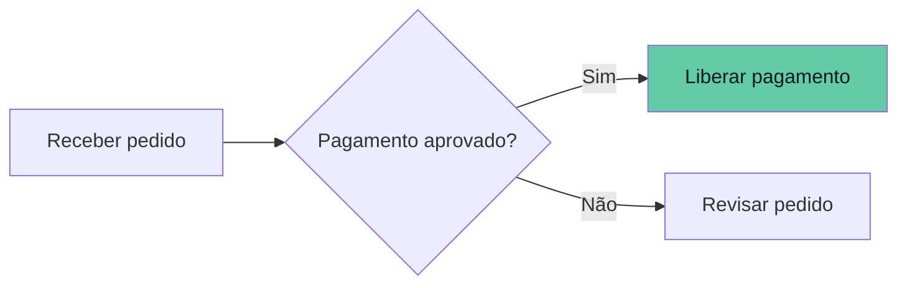

# Mermaid in the Board

Choose the family that expresses the question. Use a flowchart for branches and work ownership, a sequence diagram for exchanges over time, a state diagram for lifecycle transitions and an ER diagram for cardinality. A user-requested family takes precedence. The Mermaid editor's diagram-type menu supplies examples for the locally bundled renderer, including version-specific and beta syntax. Start from that menu when the requested family is unfamiliar.

For a .mmd file use plain Mermaid source, without Markdown fences. In a Markdown document use a mermaid fence.

Keep Mermaid identifiers stable when changing visible labels. In the Board, choose Mermaid, paste the source or import a .mmd, preview it, then apply. The editor retains the source and generates the thumbnail. A Mermaid block moves as one item; use native Board nodes when the person needs to move its internal steps independently.

For exact Mermaid source export, keep the diagram in a single Mermaid item. Exporting a mixed or native Board to .mmd generates a flowchart with its node fills, text colors and connector colors. Keep the .board file for layout coordinates, groups and the original shapes.
