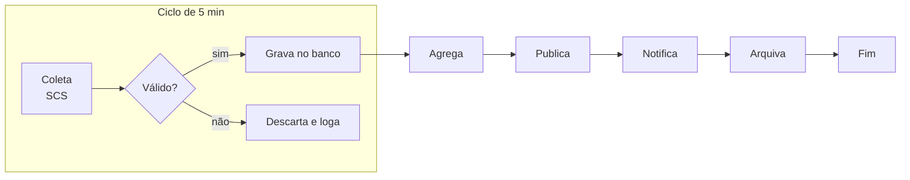
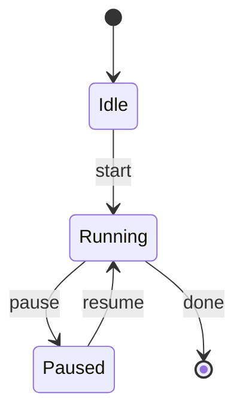
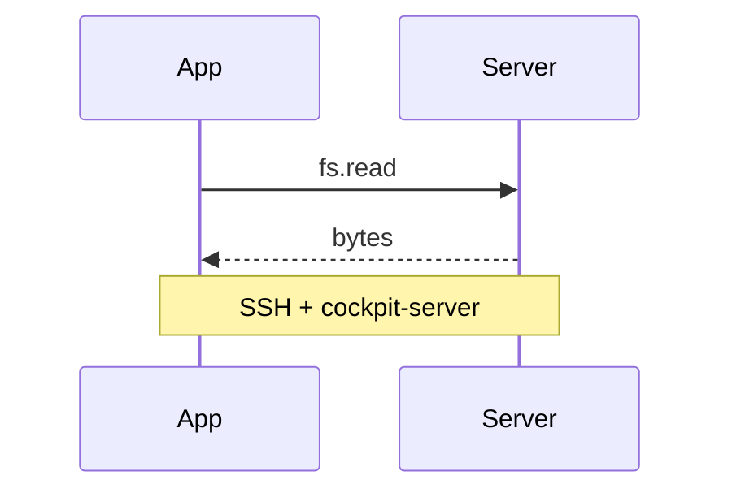
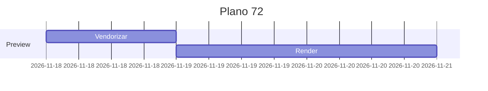
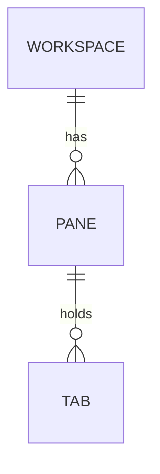
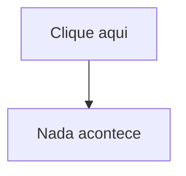

# Mermaid no preview — documento de teste (plano 72)

Abra este arquivo no Cockpit (macOS/Windows) em modo Preview. Checklist:

- [ ] Todos os diagramas abaixo renderizam, exceto o **inválido**, que mostra a
      caixa "Erro no diagrama" (localizada) + mensagem da lib + o código
- [ ] Editar este parágrafo (Código ↔ Preview, ou split) não faz nenhum
      diagrama piscar
- [ ] Editar um diagrama atualiza só ele
- [ ] O flowchart LR largo rola de lado dentro do próprio bloco, sem estourar o pane
- [ ] Trocar tema claro ↔ escuro redesenha os diagramas com as cores novas
- [ ] O `click` do flowchart "segurança" não faz nada
- [ ] Um `.md` sem diagrama: Web Inspector → `typeof window.mermaid === 'undefined'`

## Flowchart LR com subgraph e `<br/>`



## stateDiagram-v2



## sequenceDiagram



## gantt



## erDiagram



## Segurança (`securityLevel: strict`)



## Inválido

```mermaid
flowchart TD
  A -->
  isto não é mermaid ((((
```
