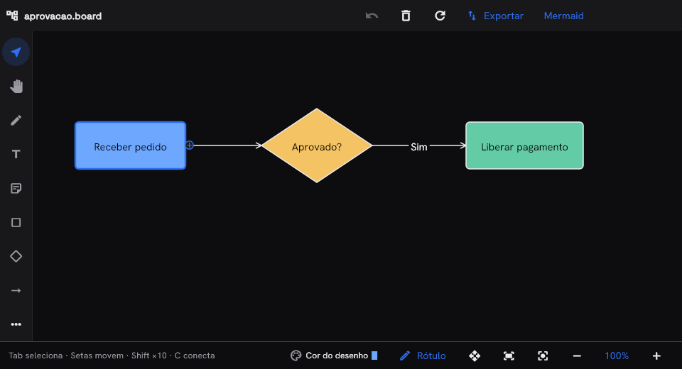
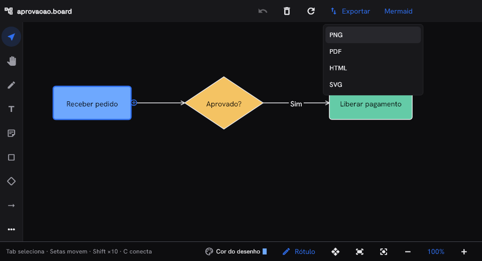

# Canvas Board • revisão de design desktop

Em 14/11/2026, a frente de design percorreu o editor Flutter desta worktree em português, com o tema escuro do Cockpit e uma superfície de 960 × 520 pixels lógicos. As capturas vieram do próprio BoardView em um teste de widget que abriu um fluxo com três etapas e dois conectores.

## Percurso da primeira revisão

1. **Selecionar uma etapa — aprovado.** O contorno azul e a alça de conexão identificam “Receber pedido”. O losango e o rótulo “Sim” explicam o caminho também sem cor. Na primeira captura a linha atravessava “Sim”. A frente Flutter abriu espaço em torno do texto e a nova captura confirmou a leitura.

2. **Abrir a paleta — aprovado.** “Cor do desenho” está visível com a etapa selecionada. Cada opção tem nome e amostra, o visto indica a cor aplicada e “Padrão do tema” permite voltar ao estado inicial. A primeira execução em pt-BR acusou 6,4 px de estouro no menu. Após o ajuste de largura e quebra do texto, o teste concluiu e a captura mostrou os sete itens inteiros.

3. **Exportar o fluxo ou uma seleção.** A ação Exportar permanece visível no cabeçalho. Primeiro se escolhe o alcance e depois o formato. A captura em português mostra os dois caminhos.

## Propostas da primeira revisão

| Prioridade | Evidência e proposta | Responsável e aceite |
| --- | --- | --- |
| Alta | O Kanban e o Canvas usam o mesmo editor na aba e na janela destacada. Preservar essa arquitetura ao ampliar o editor. | Frontend. Abrir o mesmo documento pelos dois caminhos, mover uma forma, salvar, fechar e reabrir com as ligações intactas. |
| Alta | O editor desenha objetos com CustomPainter. A barra tem nomes de ferramentas, mas o widget carece de navegação individual e de leitura das formas por tecnologia assistiva. | Frontend e design. Testar com Narrador no Windows. Navegar por duas etapas, ouvir rótulo e tipo, editar e criar uma conexão usando teclado. |
| Média | O fluxo de exportação mistura o formato e o alcance em uma lista extensa. Usar um controle de alcance com “Documento inteiro” e “Seleção” junto à lista de formatos. Mostrar formatos disponíveis para o alcance escolhido. | Design e frontend. Em um painel dividido, encontrar “Seleção → PNG” com teclado e mouse sem varrer formatos duplicados. |
| Média | O Kanban usa menus e tooltips do shadcn e os tokens comuns. O Canvas já lê context.colors e context.typo, mas usa PopupMenuButton do Material em sua paleta e nas exportações. Avaliar reaproveitamento dos menus existentes. | Frontend. Comparar foco, Escape, densidade e contraste em tema claro, escuro e importado. Validar retorno do foco ao desenho. |
| Média | As capturas do widget verificam composição, seleção e comandos. O relato de atraso pede medição com o Cockpit inteiro em hardware real. | QA desktop. Medir o p95 de construção e rasterização e os frames perdidos a 60 Hz com a cena, a máquina e o modo de compilação identificados. |

O perfil de janela destacada, temas adicionais, leitores de tela, gravação remota e latência física seguem pendentes de validação presencial. O roteiro está no [Kanban de evolução](evolucao-canvas.kanban).

## Entrega local após a revisão

O editor e o harness trabalham sobre o mesmo arquivo Markdown v3. A Gallery, a aba e a janela destacada usam o fluxo de documentos do Cockpit. O menu da aba e o controle de modo da janela alternam Quadro e Markdown com proteção do rascunho. Um teste em disco usa o arquivo de exemplo da skill, substitui seu conteúdo pelo fluxo de um harness e verifica a recarga pelo watcher e uma edição gráfica posterior.

A paleta e a exportação usam o componente de menu do Cockpit. O botão **Exportar** abre primeiro o alcance e depois o formato. O documento inteiro oferece PNG, PDF, XML, HTML, SVG, Markdown, draw.io, Excalidraw e Mermaid. A seleção oferece PNG, PDF, HTML e SVG. O diálogo sugere o nome do documento com a extensão escolhida.

O teclado percorre as formas e conexões, move a seleção e escolhe origem e destino da seta. Os testes verificam a árvore semântica e a identidade de objetos sobrepostos. O enquadramento acomoda formas com coordenadas negativas e além dos limites iniciais. A paleta e o rodapé foram testados em painéis de 280 e 420 pixels. Validação manual com Narrador, latência física e cinco sessões com pessoas continuam no Kanban.

Passaram 43 testes do domínio, editor, janela de documento, arquivos e Gallery. O teste de exportação escolheu cada um dos nove formatos pelo menu e conferiu sua gravação em disco com o nome do documento. O diálogo de destino foi substituído por um seletor de teste. A análise dos 20 arquivos de Canvas e benchmark terminou sem apontamentos e a compilação Windows Release foi concluída.

O [perfil de arraste](perfil.md) registra três rodadas por versão e tamanho de cena. Na versão atual, nenhum dos 1.440 quadros amostrados excedeu 16,67 ms por fase.

## Registro da demanda

Na continuação de 14/11, o lápis passou a registrar movimentos abaixo do limiar de arraste usado pelas formas. A caixa do traço é atualizada durante o gesto e o ponto de soltura só é adicionado quando muda. A fila de gravação reutiliza o modelo confirmado enquanto a fonte no workspace coincide com a última gravação. Um teste introduziu uma alteração independente de Markdown entre duas gravações e confirmou as três formas e o rótulo alterado após reabrir. Os PRs #316, #318 e #319 continuavam abertos para main na consulta desta etapa.

Responsável local **Canvas Board**, branch feature/canvas-board, destino main. Inventário atualizado diretamente no repositório em 14/11/2026. O recorte da pintura passou em 61 testes do Board, Gallery e abertura de documentos. Uma janela independente abriu a cópia do fluxo de aprovação no executável Windows Release. O perfil de três execuções por versão está em perfil.md e a inspeção pelo Windows está em acessibilidade.md. A frente Flutter acompanha a primeira pintura. QA desktop e produto acompanham as medições físicas e a observação com participantes no Kanban.

| PR do inventário | Destino | Responsável | Relação e encaminhamento |
| --- | --- | --- | --- |
| [#316](https://github.com/jacobaraujo7/remote_pi/pull/316) | main | moregola | Scrollback do terminal. Continuar com o autor. |
| [#318](https://github.com/jacobaraujo7/remote_pi/pull/318) | main | moregola | Clipboard. Continuar com o autor. |
| [#319](https://github.com/jacobaraujo7/remote_pi/pull/319) | main | moregola | Testes de processos, CLI e painéis. Continuar com o autor. |

Na etapa de abertura, a nova consulta manteve os três PRs acima com os mesmos destinos e encaminhamentos. Canvas Board validou o leitor com 62 testes, incluindo identificadores e conexões com escapes. O perfil separa o tempo de leitura do arquivo, interpretação do Markdown e construção do primeiro frame. A frente Flutter acompanha o custo restante do primeiro frame.
Na etapa seguinte, Canvas Board comparou doze aberturas em quatro processos Profile e registrou o custo do host e do editor em perfil.md. A seleção e a prévia de conexão passaram a reutilizar a ordem dos objetos do documento durante o movimento do ponteiro. A suíte de 62 testes passou. A consulta direta dos PRs de moregola manteve #316, #318 e #319 sob os encaminhamentos da tabela. A frente Flutter acompanha o primeiro uso do editor em processo novo.

Canvas Board validou o recorte da seleção de uma seta por seus pontos de encaixe em PNG e HTML com SVG. O PDF reutiliza o PNG. A suíte de Board, Gallery e janelas passou em 63 testes. A frente Flutter registrou 18 aberturas com três variações de conteúdo em perfil.md e acompanha a primeira composição do desenho. Na nova consulta, os PRs #316, #318 e #319 continuavam destinados a main com os responsáveis e os encaminhamentos da tabela.

Na etapa Mermaid, o documento, o editor e os exportadores reutilizam os bytes validados da miniatura enquanto estão em uso. Mover preserva a imagem e mudar a fonte sem uma nova captura remove a anterior. O teste de regressão confere essas transições e a rejeição de base64 inválido. Na primeira execução da suíte, o teste de menu expirou esperando o arquivo PNG; os 64 testes passaram na repetição com concorrência dois. As 12 aberturas comparando a mesma geometria estão em perfil.md. Canvas Board continua responsável pela próxima medição de geometria visível. Os PRs #316, #318 e #319 permaneceram em main com os encaminhamentos da tabela.

Canvas Board comparou 12 aberturas com duas larguras, mantendo o mesmo desenho. Os resultados estão em perfil.md. A geometria de um conector rotulado agora reutiliza sua rota ao calcular os limites de pintura e edição. A exportação Mermaid dos objetos nativos preserva as cores de preenchimento, texto e conexões. O diagrama de aprovação exportado foi renderizado no navegador com a biblioteca distribuída no aplicativo; o SVG apresentou o preenchimento verde e o traço rosa esperados. A suíte de 65 testes passou. A consulta do repositório manteve #316, #318 e #319 com os mesmos destinos e responsáveis. A próxima investigação de abertura cabe à frente Flutter.

Canvas Board capturou a timeline de seis aberturas em dois processos Windows. A frente Flutter acompanha o layout inicial, fase dominante nas duas primeiras construções. O conversor Excalidraw passou a manter o trajeto ortogonal e os extremos corretos das setas de retorno. O teste lê os pontos e as referências bidirecionais diretamente do arquivo exportado. A movimentação dentro do editor Excalidraw ainda precisa de validação. A suíte de Board, Gallery e janelas passou em 66 testes. A consulta dos PRs #316, #318 e #319 manteve o destino main e os encaminhamentos da tabela.

Canvas Board corrigiu o alinhamento de seleções contendo formas e conectores. O teste selecionou uma seta com duas formas em alturas diferentes, alinhou as formas pela etapa superior e desfez a operação. Os 66 testes passaram. A captura por widget e a comparação de 12 aberturas da mesma cena constam em perfil.md. As medições ainda não demonstram melhora consistente na abertura a frio. A frente de QA desktop acompanha os gestos aquecidos e a latência física. Os PRs #316, #318 e #319 continuam abertos para main com os responsáveis e os encaminhamentos da tabela.

Canvas Board validou novamente os gestos na cena densa em Windows Profile. Nenhum dos 1.440 quadros aquecidos excedeu 16,67 ms por fase. A frente QA desktop acompanha a medição física. O importador do draw.io passou a reconhecer IDs e rótulos em object e UserObject, inclusive grupos e conectores. O teste reabriu a conversão e verificou rótulos, coordenadas, extremos e rejeição de IDs repetidos. O exemplo de fluxograma do draw.io 16.5.1 conservou seus 11 elementos na conversão. A suíte de 67 testes passou. A nova consulta dos PRs #316, #318 e #319 manteve os destinos e encaminhamentos da tabela.

## Movimento de uma etapa no draw.io e no Excalidraw

O exemplo local approval.board da skill foi exportado nos dois formatos. O teste do draw.io carregou o XML no Editor oficial, inicializou o Graph em um navegador local e chamou moveCells sobre a decisão. A posição passou de (360, 80) para (430, 122). Os extremos renderizados passaram de (360, 120) e (520, 120) para (430, 162) e (590, 162). O Editor serializou o XML e o Canvas o reabriu em Markdown com os cinco IDs, rótulos e vínculos. O bundle app.min.js de jgraph/drawio usado no ensaio tem SHA-256 DB039F8314E86388DA61E7EBF4472EBDCFE63B58E92BFFD1F2DAAC961932626C.

O Excalidraw 0.18.1 carregou a cena por loadFromBlob e recebeu um arraste de mouse no canvas. Antes da correção, as duas pontas convergiam para o centro da decisão. A exportação passou a usar elbowed e pontos de ancoragem relativos aos lados. Repetido o arraste de (80, 48), a decisão ficou em (440, 128). Os extremos ficaram em (436,96; 168,01) e (603,09; 168,01), junto aos lados esquerdo e direito. Todos os segmentos continuaram horizontais ou verticais. serializeAsJSON salvou a cena e o Canvas reabriu os cinco IDs, rótulos, cores explícitas, posições das formas e extremos. A fonte Virgil externa estava indisponível no navegador isolado; o ensaio validou geometria e vínculos. Os editores de teste ficaram na pasta local de build.

Responsável Canvas Board, destino main. Os PRs #316, #318 e #319 continuam com os responsáveis e encaminhamentos da tabela. QA desktop acompanha a fala do Narrador, o trackpad, a latência física e o teste com participantes.

A compilação Windows Release de 5558fc00 abriu o fluxo de aprovação e passou pela verificação nativa registrada em acessibilidade.md. No ensaio auxiliar, solicitar o encerramento pela mesma API windowManager.destroy usada pelo Cockpit também produziu 0xC0000005 após gravar todas as 12 séries. A alteração experimental foi retirada. As pendências da frente QA desktop permanecem no Kanban. Canvas Board conferiu os PRs #316, #318 e #319; seguem destinados a main com os responsáveis e os encaminhamentos da tabela.

## Encerramento da janela de documento em Windows Release

Na build 5558fc00, duas instâncias separadas abriram uma janela de documento em desktops Win32 privados com armazenamento de teste. O ensaio enviou WM_CLOSE somente à janela visível do PID criado e aguardou o encerramento do processo. Com approval.board (PID 64504) e com README.md (PID 88124), o processo terminou com 0xC0000005. Os dois eventos Application Error 1000 identificaram coremessaging.dll 10.0.26100.9818 no deslocamento 0x491F4. Dois registros do executável auxiliar board_profile.exe também apontaram esse módulo e deslocamento. A reprodução com Markdown inclui o caminho compartilhado de janelas de documento na investigação. A causa raiz e o comportamento em um desktop interativo comum ainda precisam de verificação.

Canvas Board acompanha o diagnóstico com o dump local do PID 64504. Próximo passo: obter a pilha da thread da exceção e identificar a chamada de encerramento antes de alterar o runner compartilhado. A consulta direta ao repositório manteve os PRs #316, #318 e #319 para main com os encaminhamentos da tabela.

A leitura local de ambos os minidumps pelo DbgEng recuperou 24 frames da thread da exceção em cada processo. Os módulos e deslocamentos coincidem em todos os frames. Na ordem das chamadas aparecem ExitProcess, LdrShutdownProcess, flutter_inappwebview_windows_plugin, a tabela de encerramento do runtime C, novamente o plugin, dcomp e coremessaging. Os símbolos disponíveis são os de exportação; os nomes das funções internas do plugin permanecem indeterminados.

No fork do plugin fixado pelo pubspec.lock (b1ea7adc), InAppWebViewManager cria um compositor e um controlador de fila estáticos. Seu destrutor limpa as coleções de webviews e cancela o registro da classe de janela, sem liberar explicitamente esses recursos estáticos. Isso fornece uma hipótese testável para a chamada tardia a DirectComposition. Canvas Board acompanha um teste isolado de liberação dos recursos pelo último gerenciador antes da saída do processo, incluindo fechamento de uma janela com outra ainda aberta.

O [patch experimental do plugin](compositor-lifetime.patch) libera os recursos gráficos ao destruir o último InAppWebViewManager. Em uma cópia do bundle Windows Release, somente a DLL do plugin foi substituída. O mesmo ensaio WM_CLOSE no mesmo arquivo approval.board terminou com código 0 (PID 76180). O controle README.md também terminou com código 0 (PID 1776). Cada teste usou um processo e desktop privado próprios. A build distribuída continua usando a dependência original. Falta validar dois engines no mesmo processo e integrar o ajuste ao fork do plugin. Responsável Canvas Board. Na consulta direta, o fork flutter_inappwebview não tinha PR aberto do usuário. Os três PRs de Cockpit mantêm o destino main e os encaminhamentos já registrados.

No ensaio com o Cockpit completo, o PID 88964 exibiu as três janelas Cockpit, README.md e approval.board em um desktop privado. O Markdown fechou e o Board permaneceu visível, mas a UI Automation encontrou a view sem os objetos do desenho. Na repetição com a DLL experimental (PID 73060), o processo terminou durante o fechamento inicial. Os eventos 1000 apontaram flutter_windows.dll+0x3c16a com 0xc0000005 e 0xc000041d. O dump mostrou chamadas repetidas entre Flutter, USER32, NtUserMoveWindow e desktop_multi_window_plugin; a pilha difere da falha anterior ao sair do processo. Com a DLL original (PID 58800), o Board permaneceu visível após fechar README.md. O arraste sintético no desktop privado não produziu mudança no arquivo de controle. A edição após fechar outra janela segue sem comprovação. Canvas Board mantém o patch fora da build distribuída e acompanha o caminho de redimensionamento das janelas destacadas.

O arquivo oficial de desktop_multi_window 0.3.1 baixado de pub.dev teve SHA-256 igual ao pubspec.lock. A comparação dos fontes Windows com o diretório usado no build não encontrou diferenças. O plugin cria outro DartProject com UI em thread separada e deixa o renderizador no padrão. O runner principal desativa Impeller explicitamente. Em uma DLL experimental do segundo engine, repetir a configuração de renderização da janela principal permitiu fechar README.md mantendo a janela approval.board (PID 78156); o arraste sintético continuou sem alterar a cópia do arquivo. Essa variação não demonstra correção. Na configuração anterior, PrintWindow produziu imagens idênticas antes e depois do fechamento, ambas sem o conteúdo Flutter. Essa captura Win32 não permite determinar se o canvas efetivamente foi apresentado. Próxima validação: estabelecer um controle positivo do gesto sintético em uma janela isolada antes de interpretar o resultado com dois engines. Os PRs do Cockpit #316, #318 e #319 seguem com os encaminhamentos e o destino registrados.

O arraste via PostMessage também não alterou o arquivo na janela única, portanto esse ensaio não distingue o comportamento com dois engines. O controle positivo usou a ação MSAA para selecionar Receber pedido e a tecla de seta direita enviada à view. A janela única gravou x de 80 para 81 e fechou com código 0. Na cópia experimental com os dois plugins, o PID 73900 abriu README.md e approval.board no mesmo Cockpit. Depois de fechar README.md, o mesmo controle selecionou e moveu Receber pedido de x 80 para 81 no Board sobrevivente. As referências request → approve → release permaneceram no Markdown. Fechar o Board e depois o Cockpit retornou 0. Outra instância reabriu o arquivo salvo e moveu a mesma forma de 81 para 82, sendo esta a única diferença no segundo salvamento. O ensaio positivo cobre edição por teclado, persistência e encerramento nessa sequência; o fechamento precoce e o arraste por dispositivo físico continuam pendentes.

Fechamento na primeira observação das janelas, sem espera de oito segundos. No bundle experimental anterior, o PID 57492 caiu novamente em flutter_windows.dll+0x3c16a. Na cópia de teste do desktop_multi_window, ResizeChildContent passou a comparar a geometria atual antes de MoveWindow e WM_DESTROY passou a descartar a referência da view filha antes do teardown. Em quatro processos independentes o Board permaneceu visível após fechar o Markdown. Três completaram seleção por MSAA, movimento de x 80 para 81, verificação em disco dos dois conectores e encerramento com código zero (17572, 54812 e 60508). No quarto (21520), a view do Board permaneceu presente mas não expôs a forma ao cliente de acessibilidade em 20 segundos. O ensaio terminou antes de editar ou validar o fechamento final desse processo. O resultado ainda é parcial; os ajustes de plugin estão somente no bundle experimental. Canvas Board acompanha a inicialização do editor nesse quarto cenário. Os PRs #316, #318 e #319 permanecem destinados a main com os encaminhamentos da tabela.

## Edição pelo harness com o documento aberto

Na cópia experimental Release, um processo externo substituiu atomicamente o Markdown de um Board aberto. Alterou o rótulo da decisão e a cor de Liberar pagamento para #E69F00. A UI Automation leu o novo rótulo sem acionar Reload. Uma edição subsequente pelo teclado moveu Receber pedido de x 80 para 81. A leitura do arquivo confirmou a cor, o rótulo e os dois vínculos originais, e o processo retornou 0. O ensaio cobriu gravações sucessivas em uma janela já aberta. A skill cockpit-canvas agora descreve esse fluxo com o rótulo da Gallery. Canvas Board confirmou que os PRs #316, #318 e #319 continuam destinados a main, com os encaminhamentos da tabela.

Quando a sessão recebe outra versão do rótulo durante a edição no canvas, o clique fora do campo respeita a recusa de salvar e mantém o rascunho. Se a versão recebida já contém exatamente o rótulo digitado, a edição termina sem gravar o arquivo novamente. O teste de widget introduziu as duas versões durante a edição e conferiu texto, estado de alteração e ausência de escrita. Os quatro testes de board_view_test.dart passaram. A verificação cobre revisões já recebidas na sessão; a corrida entre leitura e gravação do arquivo por processos independentes continua sem garantia de exclusão mútua. Canvas Board acompanha essa fronteira. Os PRs #316, #318 e #319 permanecem para main com o encaminhamento já registrado.

O arraste agora aplica o deslocamento à versão da forma presente na sessão ao soltar o ponteiro. Um teste de regressão alterou posição, cor e rótulo pelo Markdown durante o gesto, verificou a composição dos deslocamentos e confirmou que soltar sobre uma forma removida não a recria nem grava novamente. Os 20 testes de editor, câmera e documento passaram. Responsável Canvas Board. A consulta dos PRs do Cockpit confirmou os mesmos três destinos e encaminhamentos.

Durante a criação de uma seta, a atualização do Markdown recalcula o encaixe na posição do ponteiro ou na forma escolhida pelo teclado. Se a origem deixa de aceitar conexão, o gesto é cancelado. O teste de regressão trocou as formas de lugar durante o gesto e conferiu o destino salvo. Também removeu e reinseriu a origem antes da soltura e confirmou que nenhuma seta foi gravada. Passaram os 21 testes de editor, câmera e documento. Responsável Canvas Board. Os PRs #316, #318 e #319 continuam para main com os encaminhamentos registrados.

O módulo AOT Windows Release atualizado (SHA-256 38DCA1CE84A8CF124B9BE5C80740169D08BE2DB461EF8CF673CB5A8EFCE138A6) rodou no bundle isolado com os plugins experimentais. Pelo teclado, o ensaio iniciou a conexão, substituiu o Markdown para mover e renomear a decisão antes de confirmar, e releu os dois extremos da nova seta, a posição e o rótulo no arquivo. O processo retornou 0. Os 51 testes em 12 arquivos de Gallery, documento, edição, teclas e exportação passaram. O build de distribuição falhou na cópia de WebView2Loader.dll, em uso pela prévia PID 15628. A janela em uso continuou aberta. Responsável Canvas Board pela validação do empacotamento.

Prévia local atualizada. Canvas Board montou um bundle separado com o AOT 38DCA1CE, assets atuais, motor oficial Release e plugins do runner de distribuição. A nova janela visível abriu uma cópia do desenho em Aprovacao-atualizada.board. O log confirmou o boot do documento e o Windows confirmou que a janela estava respondendo. O empacotamento pelo alvo padrão continua pendente enquanto a prévia anterior mantém sua DLL aberta. O bundle da prévia atual não inclui os ajustes experimentais de encerramento.

## Catálogo Mermaid offline

Os 33 exemplos de assets/board/examples.md renderizaram com SVG de largura e altura positivas no Edge headless, usando apenas as bibliotecas embarcadas (inclusive ZenUML) e resolução de hosts externos desativada. O exemplo Gantt usa datas fixas de 2014; a linha indicadora do dia atual ampliava a geometria medida para 55.497 unidades de largura. Com todayMarker off somente nesse exemplo, o desenho passou a 702,5 × 153. A segunda execução confirmou os 33 SVGs. Esse ensaio verifica sintaxe e geometria no motor do navegador; não percorre o menu nativo nem captura cada miniatura no WebView2. Responsável Canvas Board. Os PRs #316, #318 e #319 seguem para main com os encaminhamentos da tabela.

Na validação de enquadramento do editor Mermaid em Edge headless com altura útil de 421 px, nove dos 33 exemplos ultrapassaram a borda inferior antes da captura. O C4 atingiu 1.232 px. O editor agora dimensiona o SVG pela largura e altura disponíveis. Na repetição, os limites da geometria de cada SVG, transformados para coordenadas da tela, ficaram dentro da área visível nos 33 casos. O ensaio incluiu C4, ER e mindmap e usou o catálogo e as bibliotecas locais. A captura PNG feita pelo WebView2 no aplicativo ainda precisa de verificação. Canvas Board acompanha essa validação. Os PRs #316, #318 e #319 continuam com o destino e encaminhamento registrados.

Captura nativa WebView2. Um host de teste carregou o HTML do editor, o catálogo e as duas bibliotecas locais e executou CapturePreviewAsync em PNG para os 33 diagramas. O fundo implícito ficou RGB(18,18,18) nesta máquina, com texto preto no TreeView. A superfície do diagrama passou a declarar fundo branco e color-scheme light, coerentes com a configuração padrão do Mermaid. Na repetição os 33 PNGs de 460 × 421 foram distintos e continham pixels contrastantes dentro das quatro bordas. O TreeView apresentou 1.725 pixels com diferença de luminância superior a 24 sobre o fundo. O teste exercitou o runtime Windows diretamente; a sequência de abrir o menu Flutter e aplicar cada miniatura ainda não foi percorrida. Canvas Board acompanha essa verificação. Os PRs #316, #318 e #319 continuam para main com os encaminhamentos registrados.

O botão Aplicar do editor Mermaid aguarda a pintura do SVG e serializa a captura. Verifica a fonte e a rota do diálogo após a chamada assíncrona. A falha de captura mantém o diálogo disponível para nova tentativa. A análise do arquivo Flutter passou e 27 testes de documento, intercâmbio e editor passaram. A suíte cobre persistência da fonte e miniatura; os gestos no diálogo com o plugin real continuam pendentes. Canvas Board acompanha a integração. Os PRs #316, #318 e #319 permanecem para main com os responsáveis e encaminhamentos registrados.

Ao receber o resultado do diálogo Mermaid, o editor agora compara a fonte de abertura com o objeto atual e aplica a miniatura sobre a posição, cor e grupo vigentes. Remoção ou alteração incompatível da fonte impede a gravação. O teste abriu a rota real e devolveu um resultado controlado, alterando o documento enquanto a rota estava aberta. Conferiu a posição e a cor preservadas, o conflito de fonte e a ausência de recriação após exclusão. Os sete testes de board_view_test passaram. O teste substituiu o retorno do diálogo e não operou o WebView pela interface. Os PRs #316, #318 e #319 continuam para main com os responsáveis indicados. Canvas Board acompanha a validação desktop.

O runner Flutter desktop Debug executou editMermaid com o plugin Windows real e o código atual do diálogo. Para cada uma das 33 fontes do catálogo, um gesto de ponteiro acionou Aplicar quando o botão ficou habilitado. O ensaio comparou a fonte retornada com a entrada e decodificou as 33 miniaturas PNG de 434 × 514. Todas apresentaram pixels contrastantes e conteúdo distinto. O plugin registrou HRESULT de parâmetro inválido durante a execução; a captura e o retorno do diálogo completaram para todos os exemplos. As fontes entraram diretamente ao abrir o diálogo. A busca e a escolha no menu de tipos continuam pendentes de um ensaio desktop específico. Responsável Canvas Board.

Busca no catálogo pelo desktop. O ensaio Flutter com ShadcnApp, o menu do Cockpit e o WebView2 real abriu um diagrama inicial e repetiu a seleção para cada um dos 33 tipos. Alimentou o campo de busca e seu callback com o nome em maiúsculas, acionou o resultado por ponteiro, confirmou a substituição e acionou Aplicar na prévia. Conferiu igualdade da fonte retornada com a do catálogo e 33 arquivos PNG com hashes distintos. A digitação física não foi exercitada. A análise do editor, do diálogo Mermaid e dos testes de widget terminou sem apontamentos. Os PRs #316, #318 e #319 mantêm os responsáveis e encaminhamentos registrados.

Sobreposição de diagramas Mermaid. O editor intercala a miniatura com os objetos na ordem do documento. O exportador PNG desenha a miniatura na mesma passagem da forma e o PDF incorpora esse PNG. O teste de regressão verificou o pixel na interseção de uma nota vermelha e uma miniatura azul nas duas ordens e conferiu a posição dos elementos no HTML. Passaram 14 testes de editor, menu de arquivos e exportação; a análise dos arquivos alterados passou. Falta comparar a imagem no editor desktop e abrir o PDF em leitor externo. Responsável Canvas Board. Os PRs #316, #318 e #319 seguem para main com os encaminhamentos registrados.

Validação externa do PDF. Com a miniatura AgentFlow capturada no diálogo desktop, o exportador gerou duas páginas A4 com a mesma nota vermelha parcialmente sobreposta ao diagrama, invertendo apenas a ordem dos objetos. O Poppler (pdftoppm a 72 dpi) rasterizou ambas em 596 × 842. Na amostragem a cada dois pixels em cada eixo, a nota à frente apresentou 15.145 pontos vermelhos e a nota atrás apresentou 2.939, coerente com a faixa que continua visível fora da miniatura. Os PDFs de ensaio estão em cockpit/build/board-review/layers-{true,false}.pdf. A comparação da composição na janela nativa continua com Canvas Board.

O runner Flutter Debug do Windows carregou BoardView com a mesma miniatura AgentFlow do ensaio PDF e os dois documentos em Markdown. As capturas da superfície Flutter do editor mediram 1264 × 681. Com amostragem de dois pixels em cada eixo, a nota à frente exibiu 12.472 pontos vermelhos e a nota atrás exibiu 2.375. A ordem na janela coincide com a observada no PDF. O ensaio abriu BoardView diretamente em uma cópia isolada do runner. Evidências locais em cockpit/build/board-review/native-layers-true.png e native-layers-false.png. Responsável Canvas Board.

Canvas Board mediu a leitura das 33 miniaturas reais e descartou duas variantes mais lentas. O código do parser permaneceu idêntico ao original. Dados em perfil.md. O card de primeira abertura segue com a frente Flutter para medição no processo desktop. A consulta direta manteve os PRs #316, #318 e #319 para main com seus responsáveis e encaminhamentos anteriores.

Criação pela Gallery. Duas ativações do Canvas Board no mesmo workspace podiam listar os mesmos nomes antes da primeira escrita e escolher o mesmo caminho. O viewmodel agora compartilha a criação pendente por projeto e template até terminar a abertura. O teste simula duas ativações, projetos e templates diferentes, falha de escrita e novas tentativas. Passaram 16 testes de Gallery e documento, incluindo o sufixo para nome ocupado, e a análise dos três arquivos passou. Responsável Canvas Board. Falta exercitar o fluxo integral no desktop. Os PRs #316, #318 e #319 continuam com os destinos e encaminhamentos registrados.

Abertura após troca de workspace. A Gallery agora captura o projeto e a pane de origem antes da primeira espera e entrega esses identificadores à mesma fachada de abertura usada pela árvore. A leitura do arquivo e as operações de salvar e recarregar a sessão selecionam o host do projeto dono do documento. Um projeto remoto sem host resolvido retorna falha de leitura ou gravação. Os 12 testes de roteamento, criação concorrente e interação do Board passaram, assim como a análise do viewmodel. Falta reproduzir a troca durante uma gravação real no Cockpit desktop. Responsável Canvas Board; PRs #316, #318 e #319 seguem com os encaminhamentos anteriores.

Validação do workspace de origem no desktop Windows. O ensaio iniciou o shell Debug, adicionou duas pastas locais e chamou createFromTemplate duas vezes no workspace A antes de selecionar B. Ambas as chamadas devolveram a mesma operação. Ao concluir, a seleção permaneceu em B, a aba pertenceu a A e diagram.board apareceu na pasta A. Salvar a etapa Pedido na sessão em segundo plano atualizou o Markdown em A. Outra criação após voltar a A gerou diagram-2.board com identidade própria. A pasta B permaneceu vazia. O primeiro ensaio rejeitou a grafia das barras no caminho; o segundo comparou a identidade da pasta pelo sistema de arquivos. A entrada foi o viewmodel real da Gallery, sem simulação de clique físico. Resultado local em cockpit/build/board-review/gallery-20261114161956/result.txt. Responsável Canvas Board.

O shell Flutter Windows Debug abriu a aba Gallery por eventos de mouse e recebeu dois cliques consecutivos no cartão Canvas Board antes de devolver o controle ao loop de eventos. A primeira abertura exibiu BoardView e criou apenas diagram.board. Após a abertura, outro clique no cartão criou diagram-2.board e abriu o segundo BoardView. A árvore de painéis continha duas sessões de arquivo e as duas identidades no Markdown eram distintas. O ensaio usou eventos de ponteiro injetados no Flutter em um workspace local isolado. Resultado em cockpit/build/board-review/gallery-card-20261114162239/result.txt. Responsável Canvas Board.

Erro de criação pela Gallery no Windows. O shell Debug abriu o cartão em um workspace descartável no qual uma ACL temporária impediu a criação de arquivos. A interface exibiu “Could not create the file” e “Could not write the file.”. A árvore de painéis ficou sem sessão de arquivo. Após confirmar o aviso e restaurar a permissão, clicar no mesmo cartão criou diagram.board e abriu BoardView com um documento Markdown de identidade válida. Evidência em cockpit/build/board-review/gallery-error-20261114162610/result.txt. Responsável Canvas Board.

Reabertura pela árvore do Cockpit. No Windows Debug, o ensaio acionou o cartão Canvas Board e salvou pela sessão um processo azul, uma decisão e a seta Revisar. Fechou a aba pela operação closeTab e confirmou a remoção da sessão v6. Um clique de ponteiro na linha diagram.board do painel Arquivos abriu o editor na sessão v7. O Markdown recebido foi idêntico ao salvo em disco, incluindo a identidade do documento, e o pintor do canvas recebeu a ligação entre os mesmos dois IDs. O teste usou uma pasta local isolada e eventos automatizados. Resultado em cockpit/build/board-review/gallery-reopen-20261114162855/result.txt. Responsável Canvas Board.

Abrir o Markdown pela árvore. O menu de contexto dos arquivos .board oferece a mesma ação de fonte do Kanban. Cinco testes de menu passaram, incluindo .board e .BOARD. No shell Windows Debug, após criar e salvar um processo, uma decisão e uma seta, o ensaio fechou o editor e acionou o menu pelo botão secundário sobre diagram.board. A ação abriu outra sessão em modo fonte com conteúdo idêntico ao Markdown no disco. Evidência em cockpit/build/board-review/gallery-source-20261114163332/result.txt. Responsável Canvas Board. PRs #316, #318 e #319 seguem para main com os encaminhamentos registrados.

Mesmo arquivo em dois painéis. Abrir como Markdown agora aplica o modo fonte na aba do painel que recebeu o comando. Antes, a busca por caminho percorria as sessões de todos os projetos e painéis. No Cockpit Windows Debug, dois painéis abriram o mesmo diagram.board. O clique secundário na linha do painel Arquivos e a escolha da ação mantiveram o canvas original e abriram o Markdown salvo na segunda sessão. A análise do viewmodel passou. O ensaio anterior selecionava pelo nome compartilhado pelas abas e pela árvore; o ensaio final restringiu a busca à árvore. Evidência em cockpit/build/board-review/gallery-two-panes-20261114165330/result.txt. Responsável Canvas Board. Os PRs #316, #318 e #319 seguem com os encaminhamentos anteriores.

Rascunho durante uma remoção externa. Quando o Markdown exclui a forma em edição, o canvas conserva o texto modificado na posição do último campo de edição e recusa gravá-lo sobre o arquivo. O usuário pode copiar o texto e usar Escape para descartar. A regressão passou junto aos sete testes de board_view_test. No Windows Debug, o ensaio de dois painéis alterou o rascunho pelo controlador do editor, salvou pelo viewmodel da sessão Markdown e aguardou o watcher real. O pintor recebeu a outra decisão renomeada e movida. A tentativa de salvar o rascunho retornou false, preservou a exclusão em disco e o descarte limpou o indicador de alteração. Resultado em cockpit/build/board-review/gallery-sync-20261114170627/result.txt. Responsável Canvas Board. PRs #316, #318 e #319 mantêm os encaminhamentos registrados.

Avisos de conflito de texto. Enquanto o campo contém um rascunho divergente, o editor informa se o texto mudou em disco ou se a forma foi excluída. O aviso traduzido explica a cópia do rascunho e o uso de Esc. O teste verificou as duas mensagens, a preservação do texto e a remoção do aviso quando o conteúdo convergiu. Os sete testes de board_view_test passaram. O aviso usa uma região semântica de atualização; a fala do Narrador continua pendente. Responsável Canvas Board. PRs #316, #318 e #319 mantêm os encaminhamentos registrados.

Foco após conflito de rótulo. No teste do widget, uma alteração externa substituiu o texto durante a digitação. Esc fechou o campo e removeu o aviso, sem escrita em disco. A seta direita enviada imediatamente depois moveu a forma selecionada de x 40 para 41 em uma única gravação e preservou o texto externo. O ensaio utilizou eventos Flutter de teclado. A fala do Narrador permanece pendente. Responsável Canvas Board. PRs #316, #318 e #319 seguem com seus encaminhamentos.

Rótulos multilinha em SVG e HTML. Cada linha explícita recebe posição própria no SVG embutido, preservando linhas vazias internas e a cor do conector. A altura do recorte considera as linhas efetivamente renderizadas. O teste seleciona uma seta com quatro linhas, verifica o espaçamento vertical, a cor do caminho e do texto, e a ausência das formas não selecionadas. Passaram os 12 testes de intercâmbio e exportação. Responsável Canvas Board. PRs #316, #318 e #319 mantêm os encaminhamentos registrados.

Recorte horizontal de legenda longa. O Edge recebeu os arquivos SVG e HTML produzidos para uma seta isolada com três linhas de texto visíveis e uma vazia. A linha Aprovação financeira pelo responsável da tesouraria media cerca de 328 unidades e ultrapassava o viewBox nos dois formatos. A interface de exportação Flutter agora fornece a largura medida de cada linha ao cálculo dos limites. Na repetição com os mesmos textos, getBBox ficou inteiramente dentro do viewBox em todas as linhas de ambos os arquivos. Passaram os 12 testes de exportação e intercâmbio e o ensaio de geração dos arquivos. Responsável Canvas Board. PRs #316, #318 e #319 mantêm os encaminhamentos registrados.

Pesquisa dos rótulos fora do Cockpit. O fluxo approval.board foi exportado inteiro e com apenas a decisão selecionada. O pypdf encontrou uma imagem e zero caracteres de texto em cada PDF. No SVG e HTML, a leitura dos elementos de texto recuperou os quatro rótulos do fluxo completo e apenas Pedido aprovado? na seleção. A referência da skill informa essa diferença para orientar a escolha do formato. Responsável Canvas Board. PRs #316, #318 e #319 mantêm os encaminhamentos registrados.

Boards com miniaturas incorporadas. O leitor de documentos agora usa para .board o teto de 8 MiB do serviço de arquivos remoto. A gravação do editor verifica o tamanho codificado antes de substituir o arquivo. O ensaio local gravou e reabriu 132 objetos Mermaid com 33 capturas PNG repetidas em quatro grupos de amostras (2.682.664 bytes), comparando IDs, fontes e miniaturas. O teste com UTF-8 multibyte confirmou a recusa de uma gravação acima do teto e a preservação da versão anterior. Passaram 24 testes de leitura e host de documento. Responsável Canvas Board. PRs #316, #318 e #319 mantêm os encaminhamentos registrados.

Encoding na janela destacada. A tela validava o tamanho dos bytes no encoding do documento, mas o host local regravava a string em UTF-8. Agora a janela grava os mesmos bytes usados para conferir o tamanho. No teste com DocumentScreen e arquivo local real, editar Aprovação para Revisão manteve Latin-1; incluir ✅ gravou em UTF-8, com comparação byte a byte após cada operação. Os oito testes da tela de documento passaram. Responsável Canvas Board. PRs #316, #318 e #319 seguem com os encaminhamentos registrados.

Raias e contêineres. O exemplo swimlanes.board da skill liga duas equipes, uma decisão com saídas Sim e Não e um serviço agrupado. O editor e as exportações agora pintam raias e contêineres antes das conexões e das formas. O hit-test percorre a ordem inversa para que o fundo não capture o clique em uma conexão visível. O teste abre o exemplo pelo parser, verifica a ordem no SVG embutido no HTML e mede um pixel na conexão dentro da raia no PNG. Passaram 20 testes de editor, exportação e intercâmbio. Responsável Canvas Board. Os PRs #316, #318 e #319 mantêm os encaminhamentos registrados.
Durante o arraste, o editor conserva a ordem do documento entre objetos móveis e fixos. O teste manteve o ponteiro pressionado, verificou a nova coordenada do primeiro objeto e a ordem dos dois objetos nos pintores. Os sete testes do widget passaram. Responsável Canvas Board. Os PRs #316, #318 e #319 para main seguem com seus responsáveis e encaminhamentos anteriores. Próximo passo: validar o gesto no desktop com raias, grupos e conexões sobrepostas.
Contraste de legendas. A captura da janela Windows Release de Aprovação financeira.board revelou vermelho e verde escuros sobre o fundo escuro dos rótulos. O editor e o PNG agora ajustam o fundo se a razão de contraste cair abaixo de 4,5:1. O SVG escolhe um halo claro ou escuro. O teste conferiu o halo no SVG e o pixel de fundo no PNG para uma seta amarela. Passaram os 13 testes de editor e exportação. A janela aberta corresponde à compilação anterior a este ajuste. Responsável Canvas Board pela conferência visual da nova compilação. PRs #316, #318 e #319 para main mantêm os encaminhamentos anteriores.
Conferência visual Windows Release. Na cópia editável do exemplo, a captura confirmou fundo branco para os rótulos vermelho Não e verde Sim no tema escuro. A primeira prévia carregou um módulo anterior; a conferência final usou build/windows/windows/app.so gerado pelo assemble desta revisão. Evidência em cockpit/build/canvas-preview/contraste-20261114-174956/legendas-atualizadas.png. A conexão verde ainda atravessa a legenda Não ao sair da decisão. Responsável Canvas Board pelo ajuste da sobreposição. PRs #316, #318 e #319 seguem com os encaminhamentos anteriores.
Roteamento entre raias. A prévia de encaixe, o arraste, o editor e a exportação usam a distância entre as bordas para escolher encaixes laterais ou verticais. No exemplo, Sim sai abaixo da decisão e entra pelo topo de Agendar pagamento. Não continua à direita. O teste verificou o caminho no SVG desse documento; passaram os 22 testes de exportação, intercâmbio, edição e teclado. A janela de demonstração anterior ainda usa o trajeto antigo. Responsável Canvas Board pela validação desktop do novo trajeto. PRs #316, #318 e #319 para main mantêm os encaminhamentos anteriores.
Windows Release com o novo roteamento. A captura da janela confirmou Não à direita e Sim abaixo da decisão, entrando no topo de Agendar pagamento. No template da skill, o título Pagamentos foi deslocado para fora do segmento vertical e o primeiro conector recebeu azul-acinzentado para leitura sobre a raia clara. A janela recarregou o Markdown e mostrou as três conexões e seus rótulos. Evidência em cockpit/build/canvas-preview/encaixes-20261114-175846/fluxo-final.png. Os seis testes de exportação passaram. Responsável Canvas Board. PRs #316, #318 e #319 para main seguem com os encaminhamentos anteriores. Próxima validação técnica: aferir os encaixes verticais nos editores de destino.
Encaixes verticais nos editores de destino. O motor do draw.io moveu somente a decisão em (70,42), com saída em (425,185) e entrada em (572,5;280) no pagamento. No Excalidraw 0.18.1 o arraste pelo centro moveu o grupo Operações em (80,48). O arquivo salvo manteve os pontos relativos inferior e superior, quatro pontos ortogonais e o serviço fixo. A tentativa anterior com Ctrl não moveu a seleção. O navegador bloqueou a fonte Virgil externa. O Canvas reimportou os 13 objetos de ambos os arquivos, comparou todos os rótulos e os IDs de origem e destino, e reabriu a posição da decisão no Markdown. Evidências locais em cockpit/build/board-test-temp/drawio-acceptance/swim-moved.xml e excalidraw-acceptance/swim-moved.excalidraw. Responsável Canvas Board. PRs #316, #318 e #319 mantêm os encaminhamentos anteriores.
Excalidraw 0.18.1 com Virgil carregada a partir de seu pacote local. A captura inicial mostrou legendas Sim e Não cortadas pela caixa exportada de 1 × 1 e texto no topo do losango. O exportador agora centraliza os textos vinculados e calcula caixas próprias para legendas. A repetição com a rede externa bloqueada mostrou os dois rótulos e o texto Válido? centralizado, e preservou os vínculos no arraste. Evidência em cockpit/build/board-test-temp/excalidraw-acceptance/swim-font.png. Passaram 11 testes de intercâmbio e menu de arquivos. Responsável Canvas Board; PRs #316, #318 e #319 para main mantêm os encaminhamentos anteriores.
Semântica das formas na reimportação. Os conversores agora preservam o papel de retângulos especializados via estilo draw.io e customData Excalidraw. O ensaio local moveu a decisão no draw.io e seu grupo no Excalidraw e verificou tipo, ID, rótulo e vínculos dos 13 objetos após reabrir o Markdown. A regressão também cobre nota e código Mermaid em ambos os formatos. Nove testes de intercâmbio passaram. Responsável Canvas Board. PRs #316, #318 e #319 para main mantêm os encaminhamentos anteriores.
Grupos no draw.io. O XML preserva o identificador do grupo do Markdown nos metadados do grupo editável. A importação também reconhece grupos em arquivos de terceiros pelo ID da célula. Após mover a decisão e salvar no motor do draw.io, o verificador comparou os grupos dos 13 objetos, incluindo ops e payment-services, com o documento da skill e reabriu o Markdown. Os nove testes de intercâmbio passaram. Responsável Canvas Board. PRs #316, #318 e #319 para main mantêm os encaminhamentos anteriores.
O perfil atual em perfil.md verificou 1.440 quadros aquecidos, com seis acima do orçamento por fase de 160 Hz e nenhum acima de 16,67 ms. Responsável Canvas Board pela comparação controlada do arraste com a versão anterior e pelo diagnóstico do encerramento do runner. Os PRs #316, #318 e #319 continuam com seus encaminhamentos anteriores.
Comparação controlada concluída entre bc18c5a2 e o editor atual. A maior diferença consistente ocorreu no zoom; resultados e método em perfil.md. Responsável Canvas Board por investigar a reconstrução da área visível durante o zoom. PRs #316, #318 e #319 mantêm seus encaminhamentos.
Comparação isolada de cache dos limites na câmera. O zoom permaneceu em torno de 13,9 ms de intervalo p95. A variante foi retirada. Responsável Canvas Board pelo próximo perfil da camada de pintura e escala. PRs #316, #318 e #319 para main mantêm seus encaminhamentos anteriores.
Perfil da camada em 480 passos de zoom na mesma região: zero repinturas de objetos e zero reconstruções do recorte. Responsável Canvas Board pela decomposição do tempo de evento, agendamento e composição. A instrumentação ficou na pasta de build.
Perfil da entrega do evento de zoom no Windows: 480 passos instrumentados, p95 de entrega síncrona abaixo de 0,13 ms nas três rodadas. Método e limites em perfil.md. Responsável Canvas Board pela comparação com a câmera em um painel vazio para isolar o custo do conteúdo.
Comparação controlada de zoom com e sem conteúdo concluída. Documento denso acrescentou 6,8 ms à mediana dos p95 de evento até endOfFrame. Responsável Canvas Board pela investigação dos componentes visíveis (rótulos, miniatura, vetores). Resultado e limitações em perfil.md.
Ensaio fatorial de conteúdo no zoom concluído no Windows Profile. Rótulos aumentaram a rasterização em todas as comparações com vetores sem miniatura. A miniatura não teve efeito consistente. Não houve mudança no editor. Responsável Canvas Board pelas validações pendentes de abertura e interação física.
Validação integrada na branch feature/canvas-board. Os 128 testes selecionados em 16 arquivos passaram no mesmo checkout, incluindo Gallery, árvore de arquivos, modo Markdown, janela destacada, documento, editor, exportação e regressões de Kanban. O patch de diagnóstico do compositor permanece como material de revisão. A validação de Narrador, latência física e uso sem orientação continua pendente. Responsável Canvas Board.
Idioma na janela destacada. O carregamento inicial já respeitava a preferência salva. O recarregamento agora volta ao idioma do dispositivo quando a janela principal remove uma preferência explícita. O teste alternou o idioma no store, recarregou o controlador e verificou a locale ativa. Passaram 14 testes de documento e configurações. Responsável Canvas Board. O PR #318 também altera document_window_app.dart no fluxo de clipboard; esta correção está no controlador de preferências. #316, #318 e #319 mantêm seus destinos main e responsáveis.
