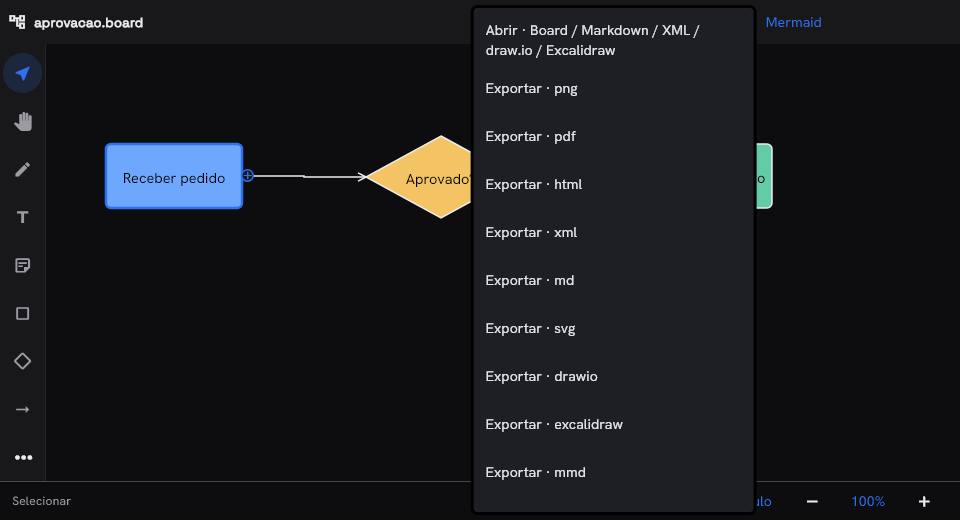
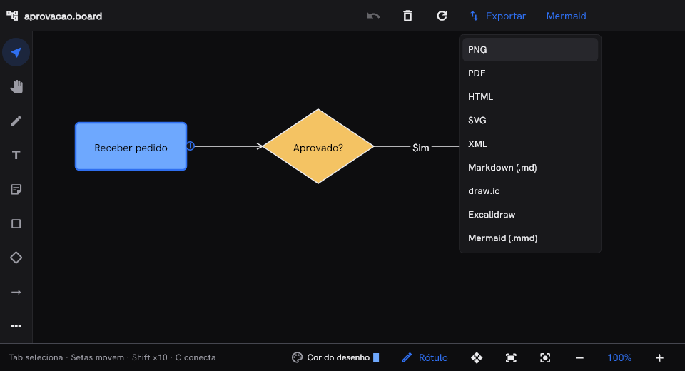

# Canvas Board • revisão de design desktop

Em 14/11/2026, a frente de design percorreu o editor Flutter desta worktree em português, com o tema escuro do Cockpit e uma superfície de 960 × 520 pixels lógicos. As capturas vieram do próprio BoardView em um teste de widget que abriu um fluxo com três etapas e dois conectores.

## Percurso da primeira revisão

1. **Selecionar uma etapa — aprovado.** O contorno azul e a alça de conexão identificam “Receber pedido”. O losango e o rótulo “Sim” explicam o caminho também sem cor. Na primeira captura a linha atravessava “Sim”. A frente Flutter abriu espaço em torno do texto e a nova captura confirmou a leitura.

2. **Abrir a paleta — aprovado.** “Cor do desenho” está visível com a etapa selecionada. Cada opção tem nome e amostra, o visto indica a cor aplicada e “Padrão do tema” permite voltar ao estado inicial. A primeira execução em pt-BR acusou 6,4 px de estouro no menu. Após o ajuste de largura e quebra do texto, o teste concluiu e a captura mostrou os sete itens inteiros.

3. **Exportar o fluxo ou uma seleção.** A ação Exportar permanece visível no cabeçalho. Primeiro se escolhe o alcance e depois o formato. A captura em português mostra os dois caminhos.

## Propostas da primeira revisão

| Prioridade | Evidência e proposta | Responsável e aceite |
| --- | --- | --- |
| Alta | O Kanban e o Canvas usam o mesmo editor na aba e na janela destacada. Preservar essa arquitetura ao ampliar o editor. | Frontend. Abrir o mesmo documento pelos dois caminhos, mover uma forma, salvar, fechar e reabrir com as ligações intactas. |
| Alta | O editor desenha objetos com CustomPainter. A barra tem nomes de ferramentas, mas o widget carece de navegação individual e de leitura das formas por tecnologia assistiva. | Frontend e design. Testar com Narrador no Windows. Navegar por duas etapas, ouvir rótulo e tipo, editar e criar uma conexão usando teclado. |
| Média | O fluxo de exportação mistura o formato e o alcance em uma lista extensa. Usar um controle de alcance com “Documento inteiro” e “Seleção” junto à lista de formatos. Mostrar formatos disponíveis para o alcance escolhido. | Design e frontend. Em um painel dividido, encontrar “Seleção → PNG” com teclado e mouse sem varrer formatos duplicados. |
| Média | O Kanban usa menus e tooltips do shadcn e os tokens comuns. O Canvas já lê context.colors e context.typo, mas usa PopupMenuButton do Material em sua paleta e nas exportações. Avaliar reaproveitamento dos menus existentes. | Frontend. Comparar foco, Escape, densidade e contraste em tema claro, escuro e importado. Validar retorno do foco ao desenho. |
| Média | As capturas do widget verificam composição, seleção e comandos. O relato de atraso pede medição com o Cockpit inteiro em hardware real. | QA desktop. Medir o p95 de construção e rasterização e os frames perdidos a 60 Hz com a cena, a máquina e o modo de compilação identificados. |

O perfil de janela destacada, temas adicionais, leitores de tela, gravação remota e latência física seguem pendentes de validação presencial. O roteiro está no [Kanban de evolução](evolucao-canvas.kanban).

## Entrega local após a revisão

O editor e o harness trabalham sobre o mesmo arquivo Markdown v3. A Gallery, a aba e a janela destacada usam o fluxo de documentos do Cockpit. O menu da aba e o controle de modo da janela alternam Quadro e Markdown com proteção do rascunho. Um teste em disco usa o arquivo de exemplo da skill, substitui seu conteúdo pelo fluxo de um harness e verifica a recarga pelo watcher e uma edição gráfica posterior.

A paleta e a exportação usam o componente de menu do Cockpit. O botão **Exportar** abre primeiro o alcance e depois o formato. O documento inteiro oferece PNG, PDF, XML, HTML, SVG, Markdown, draw.io, Excalidraw e Mermaid. A seleção oferece PNG, PDF, HTML e SVG. O diálogo sugere o nome do documento com a extensão escolhida.

O teclado percorre as formas e conexões, move a seleção e escolhe origem e destino da seta. Os testes verificam a árvore semântica e a identidade de objetos sobrepostos. O enquadramento acomoda formas com coordenadas negativas e além dos limites iniciais. A paleta e o rodapé foram testados em painéis de 280 e 420 pixels. Validação manual com Narrador, latência física e cinco sessões com pessoas continuam no Kanban.

Passaram 43 testes do domínio, editor, janela de documento, arquivos e Gallery. O teste de exportação escolheu cada um dos nove formatos pelo menu e conferiu sua gravação em disco com o nome do documento. O diálogo de destino foi substituído por um seletor de teste. A análise dos 20 arquivos de Canvas e benchmark terminou sem apontamentos e a compilação Windows Release foi concluída.

O [perfil de arraste](perfil.md) registra três rodadas por versão e tamanho de cena. Na versão atual, nenhum dos 1.440 quadros amostrados excedeu 16,67 ms por fase.

## Registro da demanda

Na continuação de 14/11, o lápis passou a registrar movimentos abaixo do limiar de arraste usado pelas formas. A caixa do traço é atualizada durante o gesto e o ponto de soltura só é adicionado quando muda. A fila de gravação reutiliza o modelo confirmado enquanto a fonte no workspace coincide com a última gravação. Um teste introduziu uma alteração independente de Markdown entre duas gravações e confirmou as três formas e o rótulo alterado após reabrir. Os PRs #316, #318 e #319 continuavam abertos para main na consulta desta etapa.

Responsável local **Canvas Board**, branch feature/canvas-board, destino main. Inventário atualizado diretamente no repositório em 14/11/2026. O recorte da pintura passou em 61 testes do Board, Gallery e abertura de documentos. Uma janela independente abriu a cópia do fluxo de aprovação no executável Windows Release. O perfil de três execuções por versão está em perfil.md e a inspeção pelo Windows está em acessibilidade.md. A frente Flutter acompanha a primeira pintura. QA desktop e produto acompanham as medições físicas e a observação com participantes no Kanban.

| PR do inventário | Destino | Responsável | Relação e encaminhamento |
| --- | --- | --- | --- |
| [#316](https://github.com/jacobaraujo7/remote_pi/pull/316) | main | moregola | Scrollback do terminal. Continuar com o autor. |
| [#318](https://github.com/jacobaraujo7/remote_pi/pull/318) | main | moregola | Clipboard. Continuar com o autor. |
| [#319](https://github.com/jacobaraujo7/remote_pi/pull/319) | main | moregola | Testes de processos, CLI e painéis. Continuar com o autor. |

Na etapa de abertura, a nova consulta manteve os três PRs acima com os mesmos destinos e encaminhamentos. Canvas Board validou o leitor com 62 testes, incluindo identificadores e conexões com escapes. O perfil separa o tempo de leitura do arquivo, interpretação do Markdown e construção do primeiro frame. A frente Flutter acompanha o custo restante do primeiro frame.
Na etapa seguinte, Canvas Board comparou doze aberturas em quatro processos Profile e registrou o custo do host e do editor em perfil.md. A seleção e a prévia de conexão passaram a reutilizar a ordem dos objetos do documento durante o movimento do ponteiro. A suíte de 62 testes passou. A consulta direta dos PRs de moregola manteve #316, #318 e #319 sob os encaminhamentos da tabela. A frente Flutter acompanha o primeiro uso do editor em processo novo.

Canvas Board validou o recorte da seleção de uma seta por seus pontos de encaixe em PNG e HTML com SVG. O PDF reutiliza o PNG. A suíte de Board, Gallery e janelas passou em 63 testes. A frente Flutter registrou 18 aberturas com três variações de conteúdo em perfil.md e acompanha a primeira composição do desenho. Na nova consulta, os PRs #316, #318 e #319 continuavam destinados a main com os responsáveis e os encaminhamentos da tabela.

Na etapa Mermaid, o documento, o editor e os exportadores reutilizam os bytes validados da miniatura enquanto estão em uso. Mover preserva a imagem e mudar a fonte sem uma nova captura remove a anterior. O teste de regressão confere essas transições e a rejeição de base64 inválido. Na primeira execução da suíte, o teste de menu expirou esperando o arquivo PNG; os 64 testes passaram na repetição com concorrência dois. As 12 aberturas comparando a mesma geometria estão em perfil.md. Canvas Board continua responsável pela próxima medição de geometria visível. Os PRs #316, #318 e #319 permaneceram em main com os encaminhamentos da tabela.

Canvas Board comparou 12 aberturas com duas larguras, mantendo o mesmo desenho. Os resultados estão em perfil.md. A geometria de um conector rotulado agora reutiliza sua rota ao calcular os limites de pintura e edição. A exportação Mermaid dos objetos nativos preserva as cores de preenchimento, texto e conexões. O diagrama de aprovação exportado foi renderizado no navegador com a biblioteca distribuída no aplicativo; o SVG apresentou o preenchimento verde e o traço rosa esperados. A suíte de 65 testes passou. A consulta do repositório manteve #316, #318 e #319 com os mesmos destinos e responsáveis. A próxima investigação de abertura cabe à frente Flutter.

Canvas Board capturou a timeline de seis aberturas em dois processos Windows. A frente Flutter acompanha o layout inicial, fase dominante nas duas primeiras construções. O conversor Excalidraw passou a manter o trajeto ortogonal e os extremos corretos das setas de retorno. O teste lê os pontos e as referências bidirecionais diretamente do arquivo exportado. A movimentação dentro do editor Excalidraw ainda precisa de validação. A suíte de Board, Gallery e janelas passou em 66 testes. A consulta dos PRs #316, #318 e #319 manteve o destino main e os encaminhamentos da tabela.

Canvas Board corrigiu o alinhamento de seleções contendo formas e conectores. O teste selecionou uma seta com duas formas em alturas diferentes, alinhou as formas pela etapa superior e desfez a operação. Os 66 testes passaram. A captura por widget e a comparação de 12 aberturas da mesma cena constam em perfil.md. As medições ainda não demonstram melhora consistente na abertura a frio. A frente de QA desktop acompanha os gestos aquecidos e a latência física. Os PRs #316, #318 e #319 continuam abertos para main com os responsáveis e os encaminhamentos da tabela.

Canvas Board validou novamente os gestos na cena densa em Windows Profile. Nenhum dos 1.440 quadros aquecidos excedeu 16,67 ms por fase. A frente QA desktop acompanha a medição física. O importador do draw.io passou a reconhecer IDs e rótulos em object e UserObject, inclusive grupos e conectores. O teste reabriu a conversão e verificou rótulos, coordenadas, extremos e rejeição de IDs repetidos. O exemplo de fluxograma do draw.io 16.5.1 conservou seus 11 elementos na conversão. A suíte de 67 testes passou. A nova consulta dos PRs #316, #318 e #319 manteve os destinos e encaminhamentos da tabela.
